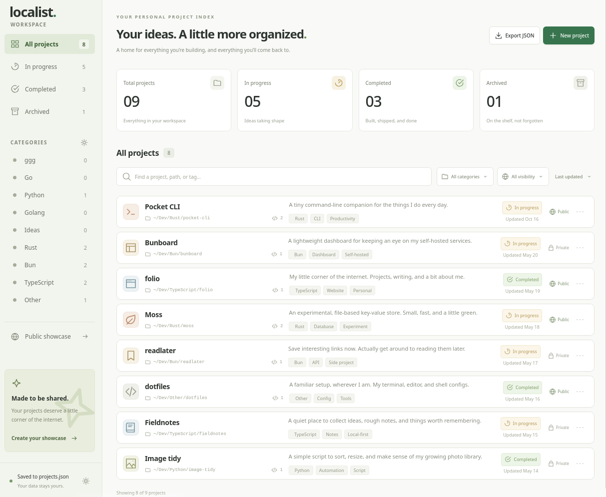
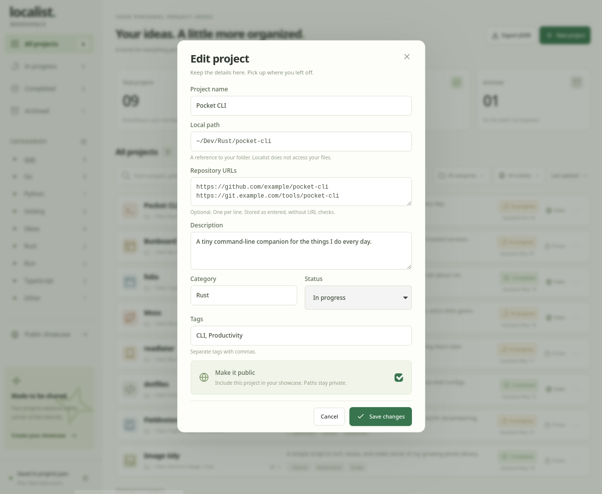
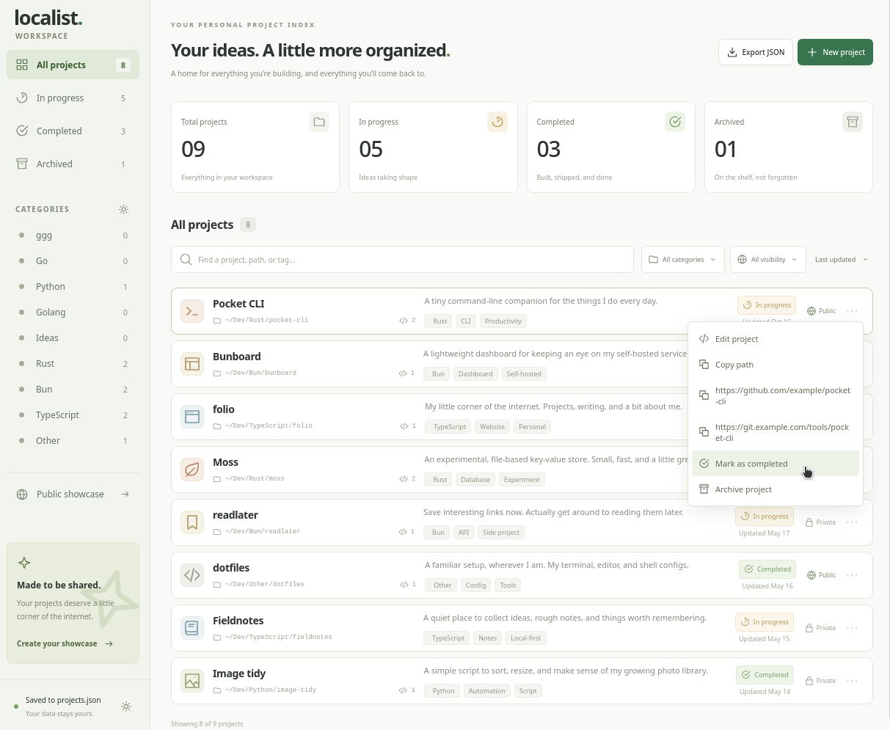
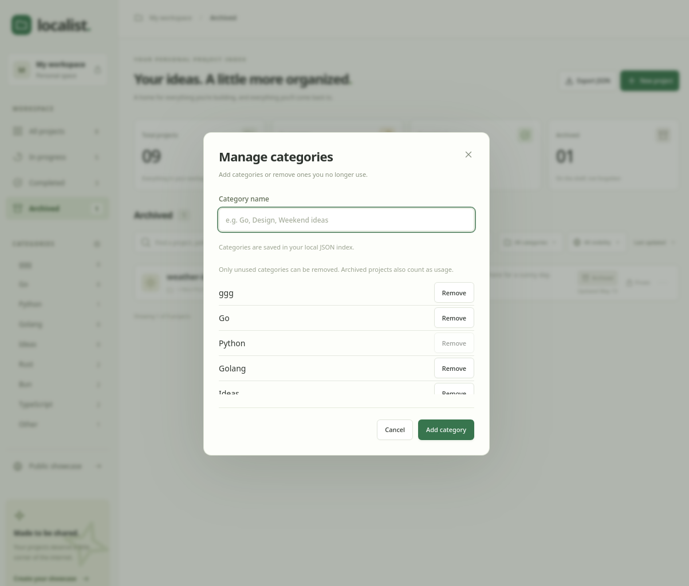
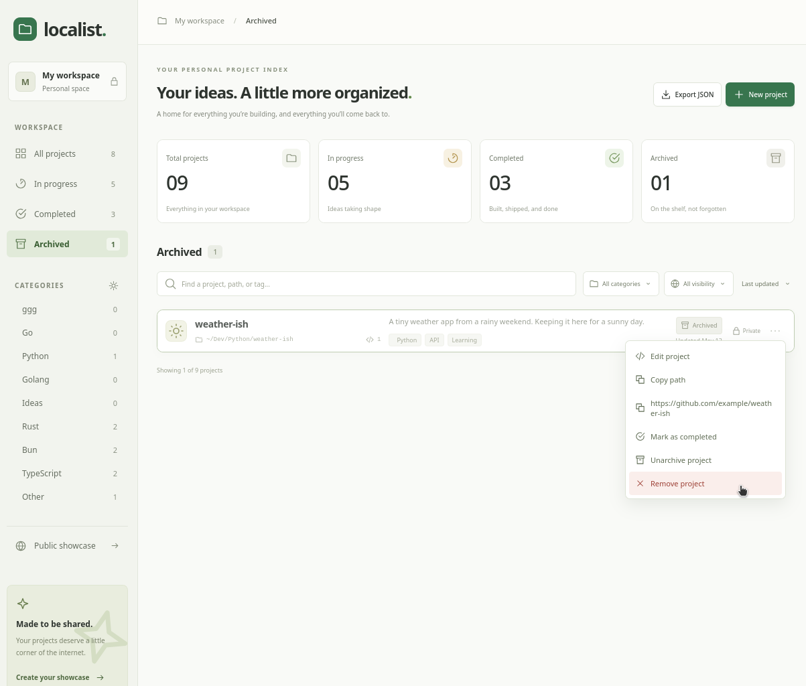

# Localist

Localist is a local project organizer for tracking folders, repository references, and project status. It runs in a browser or as a desktop app, stores your index as JSON on your computer, and can export public projects as an HTML showcase.

  

<table>
  <tr>
    <td width="50%" align="center">
      
       Project editor
    </td>
    <td width="50%" align="center">
      
       Project actions
    </td>
  </tr>
  <tr>
    <td width="50%" align="center">
      
       Category management
    </td>
    <td width="50%" align="center">
      
       Archived projects
    </td>
  </tr>
</table>

## Shared frontend

Edit `src/`, `public/`, and `index.html` once. Web and Tauri use the same frontend.

Vite selects the platform adapter at build time:

- `platform/web.js`: HTTP storage and browser downloads.
- `tauri/platform.js`: Tauri `invoke` calls to the existing Rust commands.

## Run

- Web: `bun run dev` from this directory. Keep its local server running while editing.
- Desktop: `bun run tauri dev` from `tauri/`.
- Tests: `bun run test` here, or in `tauri/` to also run the Rust tests.
- Builds: `bun run build` here for web; `bun run tauri build` in `tauri/` for desktop.

Install the existing dependencies with `bun install` in both directories when setting up a fresh checkout. The desktop folder requires its parent project.

The desktop tray offers Show / hide Localist and Quit. The title-bar Hide to tray button hides the window without quitting. Left-click toggles the window on Windows and macOS. Linux builds use the KSNI backend for left-click activation on StatusNotifier-compatible panels; the menu remains available. Showing also restores minimized windows. The window's close behavior is unchanged.

## Optional desktop publishing

In the desktop Showcase dialog, enable **Publish public projects after local saves** and save the
publishing settings. It is off by default and unavailable in web mode. For local testing, run the
server in `publish-server/` and use `http://127.0.0.1:8080` as the server URL. Other servers must use
HTTPS. The app rejects URL credentials, paths, queries, and redirects to avoid leaking its token.

The app generates one token using OS randomness and retains it in `publishing.json` beside the
native project index. On Unix this file is owner-readable/writable only. It is not encrypted or
included in project JSON backups, public snapshots, or HTML exports. Keep this settings file safe:
losing the token loses write access to the existing public URL.

Successful local saves trigger background publishing. **Publish now** uploads the currently saved
index without changing it. Native code includes only public projects, omits every `path` field,
and derives categories only from public records. Other fields on public projects, including notes
and repository references, are public. Nothing uploads when you only save publishing settings.
Publishing errors show a warning and never undo a local save. Until a successful upload, the
previous snapshot can remain public, even after you mark a project private locally.
Uploads are serialized per app
process and read the latest saved snapshot before sending.

Writes use authenticated `PUT /documents`, with `POST /documents` when the document does not yet
exist. Copy the public feed URL after enabling; it becomes readable after the first publication.
Disabling stops future uploads but does not delete a previously published snapshot. Downloaded
standalone showcases remain offline snapshots; live showcase/blog rendering is not added here.

## Data

Web data remains in `data/projects.json`. Desktop data remains in the application's data folder, usually `~/.local/share/com.mod.localist/projects.json` on Linux. Desktop exports go to Downloads. No data is moved between versions automatically.

<!--  "version": "1.20.5", // release/branch(v2(0)=>20:int)/ref-change -->
